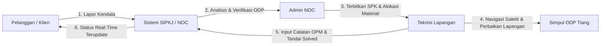

<div align="center">

# 🌐 SIPKJ — Sistem Informasi Pengelolaan Keluhan Jaringan
### Enterprise Network Complaint Management & Fiber Optic GIS Satellite System
**Regional Kalimantan Selatan (Banjarmasin & Barito Kuala)**

[](https://laravel.com)
[](https://php.net)
[](https://mysql.com)
[](https://tailwindcss.com)
[](https://leafletjs.com)
[](LICENSE)

<br/>

> **SIPKJ (Sistem Informasi Pengelolaan Keluhan Jaringan)** adalah aplikasi web terpadu untuk penyedia layanan internet (ISP / Fiber Optic Provider) yang mengotomasi alur penanganan gangguan jaringan secara *end-to-end*—mulai dari pelaporan mandiri pelanggan, verifikasi telemetri NOC, pemetaan GIS satelit tiang distribusi (ODP) & kabel transmisi, penerbitan Surat Perintah Kerja (SPK), alokasi pengeluaran material logistik, hingga penyelesaian teknis di lapangan.

</div>

---

## 📑 Daftar Isi
- [Fitur Utama](#-fitur-utama)
- [Teknologi & Arsitektur](#-teknologi--arsitektur)
- [Hak Akses & Alur Kerja Multi-Role](#-hak-akses--alur-kerja-multi-role)
- [Pemetaan GIS Citra Satelit](#-pemetaan-gis-citra-satelit-high-definition)
- [Kredensial Akun Pengujian](#-kredensial-akun-pengujian-demo)
- [Panduan Instalasi & Menjalankan](#-panduan-instalasi--menjalankan)
- [Pengujian & Standar Kualitas](#-pengujian--standar-kualitas-kode)
- [Struktur Direktori](#-struktur-direktori-proyek)
- [Lisensi](#-lisensi)

---

## 🚀 Fitur Utama

### 1. 🛰️ Pemetaan GIS Citra Satelit Resolusi Tinggi (Satellite Hybrid)
- **Visualisasi Geospasial Real-Time**: Terintegrasi menggunakan Leaflet.js dengan layer **Esri World Imagery + Reference Labels (Satellite Hybrid)**, OpenStreetMap, dan Dark Mode NOC.
- **Topologi Fiber Optic**: Memetakan simpul server pusat OLT (Optical Line Terminal), tiang distribusi ODP (Optical Distribution Point), dan status redaman/putus jaringan.
- **Polyline Jalur Kabel Transmisi**: Menampilkan bentangan kabel feeder aktif (garis biru solid) dan kabel putus / insiden (garis merah putus-putus).
- **Rute Langsung Google Maps**: Tombol pintas navigasi GPS *turn-by-turn* langsung menuju titik koordinat tiang ODP saat teknisi bertugas di lapangan.

### 2. 🎟️ Sistem Ticketing & Klasifikasi Gangguan Otomatis
- **Penerimaan Tiket Multi-Kanal**: Mendukung input tiket internal oleh NOC maupun laporan mandiri pelanggan (*Client Portal*).
- **Klasifikasi Insiden Jaringan**:
  - `OUTAGE` (Gangguan Massal / Kabel Putus / ODP Padam): Prioritas *High*, mewajibkan alokasi logistik perbaikan kabel atau konektor.
  - `ISOLIR` (Gangguan Individual Pelanggan / Tunggakan / Konfigurasi Port): Ditangani dengan verifikasi sinyal redaman.
- **Penerbitan SPK (Surat Perintah Kerja)**: NOC menugaskan teknisi lapangan yang tersedia (*Available*) disertai estimasi perbaikan dan instruksi khusus.

### 3. 📦 Logistik Material & Handover Gudang
- **Master Data Stok**: Monitoring kuantitas Dropcore FO (Roll/Meter), Fast Connector SC/UPC, Protection Sleeve, Modem ONT/ONU GPON, Adaptor, dan Splitter 1:8.
- **Alokasi Material per SPK**: Saat menerbitkan SPK, NOC dapat mengeluarkan material gudang yang langsung memotong stok secara real-time.
- **Audit Pengeluaran Logistik**: Riwayat lengkap material keluar yang mencatat kode transaksi, nomor tiket, nomor SPK, teknisi penerima, dan approval NOC.
- **Ekspor Dokumen**: Cetak laporan ramah printer (PDF) dan ekspor CSV/Excel sekali klik.

### 4. 📱 Tampilan Responsif & Desain Minimalis Modern
- **100% Native Laravel Blade + Tailwind CSS**: Performa cepat tanpa overhead framework SPA yang berat.
- **Margin Kompak & Rapi**: Tata letak *fluid width* yang presisi di semua resolusi layar (desktop ultrawide, laptop, tablet, hingga smartphone).
- **Ikon Garis Minimalis (SVG)**: Antarmuka bersih profesional menggunakan SVG line icons terstandarisasi.
- **Widget Telemetri Cepat**: Indikator persentase topologi online regional Kalsel langsung di sidebar navigasi.

---

## 🛠️ Teknologi & Arsitektur

| Komponen | Spesifikasi / Library | Keterangan |
| :--- | :--- | :--- |
| **Framework Backend** | Laravel 12 (PHP 8.3+) | Routing, Eloquent ORM, Middleware, Service Container |
| **Basis Data** | MySQL 8.0+ | Relasi tabel `users`, `topology_nodes`, `materials`, `tickets`, `work_orders`, `material_outbounds` |
| **Frontend Template** | Laravel Blade Engine | Server-Side Rendering (SSR) yang aman, ringan, dan SEO-friendly |
| **CSS Styling** | Tailwind CSS 3.4 + Vite | Utilitas CSS modern dengan palet warna ISP enterprise |
| **Pemetaan GIS** | Leaflet.js 1.9.4 | Peta interaktif, marker kustom, layer satelit Esri World Imagery |
| **Visualisasi Grafik** | Chart.js 4.4 | Grafik performa SLA & tren tiket mingguan |
| **Code Style** | Laravel Pint | Pemformatan standar PSR-12 kode PHP |
| **Test Suite** | PHPUnit | Pengujian otomatis end-to-end fitur & otentikasi role |

---

## 👥 Hak Akses & Alur Kerja Multi-Role

Aplikasi ini dirancang dengan kontrol akses berbasis peran (*Role-Based Access Control*):



### 1. 🛡️ Admin NOC (Network Operations Center)
- Memantau telemetri seluruh simpul OLT dan ODP di Kalsel.
- Melakukan diagnosa simpul putus (*Fiber Cut*) melalui live GIS Map.
- Menganalisis tiket keluhan pelanggan, memilih teknisi yang bertugas, dan mendistribusikan material dari gudang logistik.
- Mengelola data master topologi dan mencetak rekapitulasi laporan logistik.

### 2. 🔧 Teknisi Lapangan (Field Engineer)
- Menerima lembar tugas SPK aktif secara digital.
- Melihat daftar material yang telah dialokasikan oleh pihak logistik/NOC.
- Mengakses peta satelit tiang ODP dan menavigasi rute perbaikan lewat Google Maps.
- Menginput hasil pengukuran daya optik (OPM dBm) dan menandai status tiket menjadi `Solved`.

### 3. 👤 Klien (Pelanggan Mandiri)
- Memantau status paket internet dan titik sambung distribusi ODP rumah secara transparan.
- Membuat laporan keluhan jaringan mandiri secara cepat.
- Memantau proses penanganan gangguan melalui *3-Step Progress Tracker* (`Diterima` ➔ `Ditugaskan` ➔ `Selesai`).

---

## 🛰️ Pemetaan GIS Citra Satelit (High Definition)

Pemetaan satelit diterapkan secara spesifik pada menu-menu berikut:

1. **Menu Data Topologi (`/topologi`)**:
   - Peta GIS utama berukuran 480px dengan layer switch (*Citra Satelit HD*, *Peta Jalan OSM*, *Dark Mode NOC*).
   - Tombol fokus cepat: `Fokus Banjarmasin` dan `Fokus Barito Kuala`.
   - Menghubungkan jalur kabel optik dari OLT ke ODP dan menampilkan popup data redaman serta port.

2. **Menu Dashboard (`/dashboard`)**:
   - Peta live diagnostic telemetri tersemat di kartu monitoring jaringan.
   - Mengklik kartu status perangkat di bawah peta akan otomatis mengarahkan kamera (*flyTo*) ke koordinat simpul tersebut.

3. **Menu Keluhan & Tiket (`/tiket`)**:
   - Modal analisis tiket menampilkan peta satelit mikro untuk mengidentifikasi letak tiang ODP pelanggan yang bermasalah sebelum SPK dikirim.

4. **Portal Teknisi (`/teknisi/portal`)**:
   - Setiap SPK dilengkapi tombol **Peta Satelit Tiang & Rute GPS** untuk panduan teknisi langsung ke tiang target di lapangan.

5. **Portal Klien (`/klien/portal`)**:
   - Pelanggan dapat melihat titik sambung kabel distribusi rumah mereka pada peta citra udara beresolusi tinggi.

---

## 🔑 Kredensial Akun Pengujian (Demo)

Aplikasi telah dilengkapi seeder akun untuk mempermudah pengujian:

| Role | Username | Password | Deskripsi / Penugasan |
| :--- | :--- | :--- | :--- |
| **Admin NOC** | `admin_noc` | `password123` | Akses penuh dashboard, topologi, tiket, logistik, & laporan |
| **Teknisi Lapangan** | `teknisi_rizky` | `password123` | Teknisi Wilayah Banjarmasin (Rizky Ramadhan) |
| **Teknisi Lapangan** | `teknisi_noor` | `password123` | Teknisi Wilayah Barito Kuala (Noor Hidayat) |
| **Klien / Pelanggan** | `klien_sulaiman` | `password123` | Pelanggan Area Kayutangi (Haji Sulaiman) |
| **Klien / Pelanggan** | `klien_rahmah` | `password123` | Pelanggan Area Handil Bakti (Siti Rahmah) |

> 💡 **Fitur Switch Role Cepat**: Pada bagian kanan header atas (Top Header), tersedia tombol cepat untuk berganti role secara instan tanpa perlu logout-login berulang kali.

---

## ⚙️ Panduan Instalasi & Menjalankan

### Prasyarat Sistem
- PHP 8.2 atau 8.3+ (Ekstensi aktif: `pdo_mysql`, `mbstring`, `openssl`, `tokenizer`, `xml`, `ctype`, `json`, `curl`)
- Composer 2.x
- Node.js 18+ & NPM
- MySQL Server 8.0+

### Langkah-Langkah Setup

1. **Clone Repositori**:
   ```bash
   git clone https://github.com/Irpanai/sistem_ro.git
   cd sistem_ro
   ```

2. **Instal Dependensi PHP & JavaScript**:
   ```bash
   composer install
   npm install
   ```

3. **Konfigurasi Environment (`.env`)**:
   Salin file contoh konfigurasi dan sesuaikan pengaturan database MySQL:
   ```bash
   cp .env.example .env
   ```
   Pastikan pengaturan basis data pada `.env` telah sesuai:
   ```ini
   DB_CONNECTION=mysql
   DB_HOST=127.0.0.1
   DB_PORT=3306
   DB_DATABASE=network
   DB_USERNAME=root
   DB_PASSWORD=
   ```

4. **Generate Application Key**:
   ```bash
   php artisan key:generate
   ```

5. **Migrasi Database & Seeding Data Awal**:
   Jalankan migrasi untuk membuat tabel dan mengisi data dummy simulasi jaringan Kalimantan Selatan:
   ```bash
   php artisan migrate:fresh --seed
   ```

6. **Kompilasi Aset Frontend (Vite)**:
   ```bash
   npm run build
   ```
   *(Atau jalankan `npm run dev` jika ingin mode hot-reload)*

7. **Jalankan Server Lokal**:
   ```bash
   php artisan serve
   ```
   Buka peramban di: **[http://127.0.0.1:8000](http://127.0.0.1:8000)**

---

## 🧪 Pengujian & Standar Kualitas Kode

Proyek ini telah dilengkapi automated testing dan code formatter standar Laravel:

- **Menjalankan PHPUnit Test**:
  ```bash
  php artisan test
  ```
  *Seluruh test mencakup verifikasi status kode HTTP, akses rute multi-role, dan pemuatan peta.*

- **Memeriksa & Merapikan Format Kode (Laravel Pint)**:
  ```bash
  vendor/bin/pint --format agent
  ```

---

## 📁 Struktur Direktori Proyek

```text
sistem_ro/
├── app/
│   ├── Http/Controllers/
│   │   ├── AuthController.php               # Otentikasi & demo switch role
│   │   ├── ClientPortalController.php       # Portal mandiri pengaduan pelanggan
│   │   ├── DashboardController.php          # NOC telemetry & analytics
│   │   ├── MaterialController.php           # Master stok & restock logistik
│   │   ├── ReportController.php             # Laporan material & ekspor CSV
│   │   ├── TechnicianPortalController.php   # Work order SPK & peta teknisi
│   │   ├── TicketController.php             # Manajemen tiket & dispatch SPK
│   │   ├── TopologyController.php           # Master GIS OLT/ODP & status kabel
│   │   └── WorkOrderController.php          # Resolusi SPK teknisi (Solved)
│   └── Models/                              # Eloquent Models (User, Ticket, TopologyNode, dll)
├── database/
│   ├── migrations/                          # Skema tabel MySQL
│   └── seeders/DatabaseSeeder.php           # Data dummy ISP Kalimantan Selatan
├── resources/
│   ├── css/app.css                          # Konfigurasi Tailwind CSS
│   ├── js/app.js                            # Inisialisasi JavaScript
│   └── views/
│       ├── layouts/                         # Master template, header, sidebar minimalis
│       ├── auth/login.blade.php             # Halaman login modern
│       ├── dashboard/index.blade.php        # Dashboard NOC dengan live GIS map
│       ├── topologi/index.blade.php         # Peta GIS Satelit & tabel OLT/ODP
│       ├── logistik/index.blade.php         # Manajemen pergudangan material
│       ├── tiket/index.blade.php            # Ticketing & modal dispatch SPK
│       ├── teknisi/portal.blade.php         # Portal tugas teknisi lapangan
│       ├── klien/portal.blade.php           # Portal mandiri pelanggan
│       └── laporan/index.blade.php          # Rekapitulasi audit logistik
├── tests/
│   └── Feature/SipkjPagesTest.php           # Feature test halaman dan otentikasi
├── package.json                             # Dependensi Tailwind & Vite
└── composer.json                            # Dependensi Laravel & PHP
```

---

## 📄 Lisensi

Proyek ini dirilis di bawah lisensi terbuka [MIT License](LICENSE). Bebas digunakan, dipelajari, dan dikembangkan untuk keperluan operasional telekomunikasi maupun edukasi.
